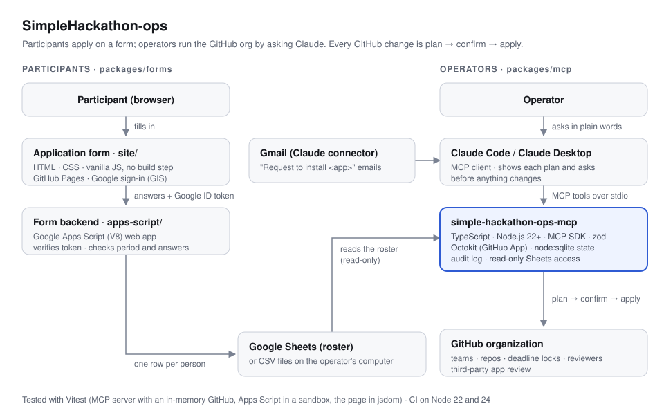

# SimpleHackathon-ops

해커톤 운영 오픈소스 키트입니다. **참가 신청 폼**으로 신청을 받고, **MCP 서버**로 GitHub org를 운영합니다.
운영진은 Claude에게 말로 시키고, GitHub을 바꾸는 일은 항상 "계획 → 확인 → 적용" 순서로만 일어납니다.

[](LICENSE)
[](https://nodejs.org)
[](packages/mcp)
[](https://modelcontextprotocol.io)
[](packages/forms/apps-script)
[](packages/forms/site)
[](https://www.npmjs.com/package/simple-hackathon-ops-mcp)



처음 쓴 대회는 [ENDPoinT 2026](https://2026endpoint.github.io)(서울과학기술대학교 컴퓨터공학과 해커톤)입니다.

## 들어 있는 것

| 폴더 | 무엇 | 스택 |
| --- | --- | --- |
| [`packages/forms`](packages/forms) | 참가 신청 폼. GitHub 아이디까지 받고, 서버가 기간·입력을 검사해 구글 시트에 씁니다 | HTML·CSS·JS(빌드 없음), GitHub Pages, Google Apps Script, Google Sheets |
| [`packages/mcp`](packages/mcp) | MCP 서버 [`simple-hackathon-ops-mcp`](https://www.npmjs.com/package/simple-hackathon-ops-mcp). 팀·repo 생성, 조장 maintainer, 마감 잠금·풀기, 멘토·심사위원 읽기 권한, 앱 설치 요청 판정, 일정 토글 | TypeScript, Node.js 22+, MCP SDK, zod, Octokit, node:sqlite |
| [`config`](config) | 대회 설정 양식, 앱 정책, 팀 README 양식, 환경 변수 목록 | YAML |
| [`docs`](docs) | 그림과 문서 | |

## 빠른 시작

1. **신청 받기**: [`packages/forms`](packages/forms#설치)대로 시트에 Apps Script를 붙이고, `site/`를 GitHub Pages에 올립니다. 질문은 `Config.gs`에서 고칩니다.
2. **MCP 연결**: GitHub App을 만들어 대회 org에 설치하고, Claude Code나 Claude Desktop에 서버를 등록합니다.
   ```bash
   claude mcp add simple-hackathon-ops --scope user \
     -e HACKATHON_OPS_HOME=$HOME/hackathon-ops \
     -e GITHUB_APP_ID=123456 -e GITHUB_APP_PRIVATE_KEY_PATH=/path/to/key.pem \
     -- npx -y simple-hackathon-ops-mcp
   ```
3. **운영**: "새 대회 만들어줘, 명단은 이 시트로" → "명단 확인해줘" → "팀 만들고 초대해줘" → "마감 잠가줘"처럼 말합니다. 바뀔 목록을 먼저 보여 주고, 확인한 뒤에만 적용합니다. 자세한 흐름은 [`packages/mcp`](packages/mcp#대회-흐름)에 있습니다.

## 지키는 것

- GitHub 변경은 계획을 먼저 보여 주고 확인 코드가 있어야 적용됩니다. 그사이 상황이 바뀌면 적용하지 않습니다.
- 참가자가 다른 팀 코드를 볼 수 없게 합니다. 멘토·심사위원은 읽기만, 마감 전에는 public 전환을 막습니다.
- 명단은 읽기만 하고, 도구 응답에 이메일을 내보내지 않습니다. 대회가 끝나면 로컬 기록의 개인정보를 지웁니다.
- 앱 승인과 2FA 강제처럼 GitHub이 API를 열어 두지 않은 일은 사람이 GitHub 화면에서 합니다. 도구는 판단 근거와 링크를 줍니다.

## 개발

```bash
npm install          # 저장소 루트에서 (npm workspaces)
npm test             # MCP 66개 + 폼 12개 테스트
npm run typecheck
npm run build
npm run smoke        # 빌드된 MCP 서버를 실제 MCP 클라이언트로 띄워 확인
```

```
.
├── packages/
│   ├── mcp/        MCP 서버 (npm: simple-hackathon-ops-mcp)
│   └── forms/      신청 폼: site/ (GitHub Pages) + apps-script/ (Apps Script)
├── config/         설정 양식 (event.example.yaml, app-policy.yaml, …)
├── docs/           그림
└── workspace/      내 대회 설정과 기록 (git 제외)
```

기여 방법은 [CONTRIBUTING.md](CONTRIBUTING.md)를 보세요.

## License

[MIT](LICENSE)
